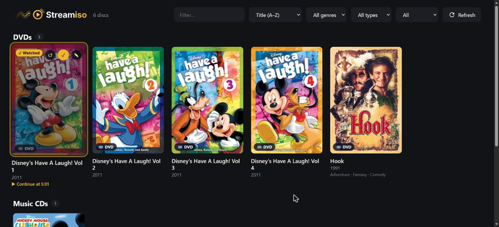
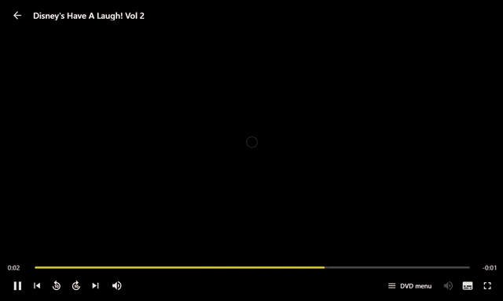

<p align="center">
  <picture>
    <source media="(prefers-color-scheme: dark)" srcset="assets/logo-dark.svg">
    
  </picture>
</p>

<p align="center">
  <b>Your DVD ISO and audio CD collection, as a self-hosted streaming library.<br>
  Real DVD menus, in any browser or on your TV.</b>
</p>

<p align="center">
  
  
  
  
  
</p>

# StreamISO

StreamISO scans folders of DVD `.iso` images and audio CD images (`.cue` + `.bin`), shows them as a poster grid,
and plays them with the original menus, extras, audio tracks and subtitles. Playback is **real disc navigation**
(VLC + libdvdnav) running on your server and streamed to the browser over WebRTC, so a TV or any device with a
modern browser can use your discs without decoding anything itself.

> **Status: early prototype (v0.6).** Built for a single viewer on a home network. See [Limitations and security](#limitations-and-security).

## Screenshots

<p align="center">
  <br>
  <sub>StreamISO user catalog</sub>
</p>

<p align="center">
  <br>
  <sub>Navigating a DVD's real menus in the browser (VLC + libdvdnav, streamed over WebRTC)</sub>
</p>

## About this project (read this first)

**StreamISO is a "vibe coded" project.** It was designed, written and debugged in a long conversation between its
author, who steered the idea and tested every build on a real home server, and an AI assistant
([Claude](https://claude.ai) by Anthropic), which wrote essentially all of the code and this documentation.

What that means in practice:

- It works for the author's setup, but it has had **no formal code review, no security audit and no automated test suite**.
  Individual pieces were exercised with a real VLC, real disc images and mock servers during development; that is not the same as a test suite.
- The author tested the play button, DVD menus, audio CDs and resume on a Windows PC with Docker Desktop and on a phone browser (see [Running on Windows](#running-on-windows)).
  Other setups (Linux servers, TVs, other browsers) and the TMDB lookups have had less testing, and some pieces were only checked against simulated services while building.
  If something misbehaves, please open an issue with the details.
- Treat it as a home-lab tool. Read the code before you trust it, and do not expose it to the internet.

Bug reports, fixes and tests are very welcome. See [Contributing](#contributing).

## Why this exists

A shelf of DVDs and CDs you own is awkward to use: the discs are in a box, the TV has no drive, and ripping to
plain video files throws away the menus, extras, language and subtitle choices that make a DVD a DVD.

StreamISO keeps the disc **as it is** (an `.iso` or a BIN/CUE image) and gives it a modern front door: a poster library,
search and filters, covers and metadata, a streaming-style player with a seek bar, and "continue where you left off".
The server does the work that an old DVD player would do, and any screen with a browser becomes the TV.

## Features

**Library**
- Poster grid with search, sorting and filters (genre, type, watched / listened), separate **DVDs** and **Music CDs** sections
- Automatic covers, synopses, years and genres: **TMDB** for DVDs (free API key), **MusicBrainz + Cover Art Archive** for CDs (no key)
- Smart matching for long file names (falls back to shorter names, down to the series name), plus a **Search again** button in the editor for manual searches
- Season discs get the poster of their own season (`Show S02 D1.iso`, or a season set in the editor)
- The discs of a season, or of a film on several discs (`Titanic Disc 2.iso`), form one card
- **Choose online poster** in the editor shows every poster TMDB has for the title, and the other titles the search finds
- Metadata you control: title, year, genres, synopsis, **season / disc number**, watched flag, custom cover
- Covers are always shown whole (centered over a blurred copy of themselves); audio CD covers are square
- Edits are tied to a fingerprint of each image, so renaming or moving files loses nothing
- Navigable with arrow keys (TV remote)

**DVD playback**
- The actual disc: menus, buttons, chapters, extras, audio and subtitle selection (VLC + libdvdnav)
- Streaming-style control bar: play/pause, seek bar with times, chapter skip, ±10 s, volume, audio and subtitle menus, **DVD menu** button, fullscreen
- A big play button starts the disc, so the menu never starts half-played and the browser allows sound
- Remote-friendly: media keys and arrow keys work; menu navigation falls back to VLC directly when the stream does not have keyboard control

**Audio CDs (BIN/CUE)**
- Cover, artist, track list, previous/next track, gapless playback
- Track titles and artists from the cue sheet

**Resume**
- Remembers where you stopped, for DVDs and CDs (track and time). A progress bar shows on the poster, click to continue, **↺** to start over

**Setup**
- Docker Compose, no GPU required, no build step for the front end
- Separate folders for DVDs and CDs (`DVD_DIR`, `CD_DIR`)

## How it works

```
Browser / TV ──> catalog (port 8080) ── writes ──> ./state/current ──> launcher starts VLC
      │               │
      │               └── player controls ──> VLC remote-control port 4212 (internal only)
      └───────── WebRTC (port 8081) <── Neko + VLC
                   video, audio, key presses
```

- **catalog**: a small Flask service. Scans the images, serves the library UI and API, stores your edits and resume positions, looks up covers, and tells the player which disc to open.
- **neko**: the [Neko](https://github.com/m1k1o/neko) VLC image. VLC opens the ISO with `dvdnav://`, so the disc menu is interpreted on the server exactly like a hardware player. Neko captures that screen and streams it over WebRTC; key presses from your browser or remote go back to VLC.
- **launcher** (`neko/launcher.sh`): runs inside the Neko container, watches the state file written by the catalog and (re)starts VLC for the chosen disc.
- **player page** (`/player`): embeds the Neko stream (`cast=1`, which makes Neko hide its own buttons) and draws the control bar on top. The bar talks to the catalog, which relays commands to VLC's remote-control (rc) interface, so seeking, volume, tracks and chapters are real VLC operations.
- One viewing session at a time: opening another disc replaces the current one.

## How it was built

Some of the decisions behind the code, for anyone reading or contributing:

- **Do not re-implement a DVD player.** DVD menus are programs (a virtual machine on the disc). VLC with libdvdnav already runs them, so StreamISO drives a real VLC and streams its screen, instead of trying to play ISO files in the browser.
- **Neko for the streaming.** Neko already turns a Linux desktop into a low-latency WebRTC stream with input forwarding. StreamISO uses its VLC image as is, and adds a small injected script (`neko/neko-inject.html`, applied at container start by `neko/patch-neko.sh`) that reports mouse activity, media keys and "video is ready" to the page that embeds it.
- **VLC's rc interface as the control channel.** Everything the control bar does (state, time, seek, volume, chapters, audio and subtitle tracks, DVD menu) goes through VLC's text-based remote-control interface on an internal port. `catalog/vlcrc.py` is a small client for it.
- **Audio CDs as one continuous raw stream.** A BIN image is played with VLC's `rawaud` demuxer as a single 44.1 kHz stereo stream, and a track is just a time offset taken from the cue sheet (`catalog/cdimage.py`). That gives gapless playback and cheap seeking.
- **Discs open paused.** The browser's audio and video connect a moment after VLC starts, so the first seconds used to be lost. VLC now starts paused and is released once the browser is connected (CDs) or the viewer clicks the big play button (DVDs).
- **Resume by position, not by file.** Positions are saved from the player's status poll and keyed by the image fingerprint, so they survive renames. A DVD is resumed by jumping to the saved title and time through rc while still paused.
- **Plain files, no database.** The catalog is rebuilt in memory from a folder scan. User edits live in `data/library.json`, covers and lookup results in `data/`, and the "what is playing" state in a single file shared with the launcher.
- **No front-end build.** The UI is plain HTML, CSS and JavaScript served by Flask, with no framework and no external requests.

## Technical overview

**Languages and sizes** (about 3,800 lines in total, without documentation)

| Language | Where | Lines |
|---|---|---|
| Python 3.12 | `catalog/*.py`: Flask service, VLC client, cue parser, MusicBrainz client | ~1,560 |
| JavaScript (vanilla, no build) | `catalog/static/app.js` (library), the script inside `player.html` (player) and `neko/neko-inject.html` (bridge) | ~1,350 |
| HTML and CSS | `catalog/static/*.html`, `style.css` | ~690 |
| Bash | `neko/launcher.sh`, `neko/patch-neko.sh` | ~110 |
| Config | `docker-compose.yml`, `Dockerfile`, `neko/vlc.conf` (supervisord) | ~110 |
| SVG | logo and icons in `assets/` and `catalog/static/` | |

**Tools and components**

| Tool | Role |
|---|---|
| Flask + Gunicorn | HTTP server. One worker with 8 threads, because the catalog lives in memory and is shared between threads |
| VLC 3 (inside Neko) | Plays the discs. `dvdnav://` for DVD menus, the `rawaud` demuxer for raw CD images, and the `rc` remote-control interface for the control bar |
| Neko | Streams the VLC screen over WebRTC and forwards keyboard and mouse. Runs VLC under supervisord, with a lightweight window manager |
| Docker Compose | Two services, `neko` and `catalog`, sharing a read-only media mount and a `state/` folder |

Used only while developing (not part of the repository): a real VLC, ffmpeg, dvdauthor and genisoimage to build test discs,
headless Chromium with Playwright for UI checks, and small mock servers standing in for TMDB, MusicBrainz and the Cover Art Archive.

**Ports**

| Port | Service | Published |
|---|---|---|
| 8080 (`CATALOG_PORT`) | Catalog web UI and API | yes |
| 8081 (`NEKO_PORT`) | Neko web UI (WebRTC signalling) | yes |
| 52000-52100/udp | WebRTC media | yes |
| 4212 | VLC remote control (rc), no authentication | **no**, internal network only |

**Files the app writes**

| Path | Content |
|---|---|
| `data/library.json` | Your edits (title, year, genres, season, watched, ...), keyed by disc fingerprint |
| `data/resume.json` | Saved playback positions, keyed by disc fingerprint |
| `data/meta/<id>.json` | Cached TMDB / MusicBrainz results (a `miss` flag records "nothing found") |
| `data/covers/<id>.jpg` | Covers downloaded from TMDB or the Cover Art Archive |
| `data/covers_custom/<fingerprint>.*` | Covers you uploaded |
| `state/current` | The disc being played, read by the launcher (see below) |

**Identifiers.** A disc `id` is the first 12 characters of the SHA-1 of its relative path. Your edits and positions use a
separate **fingerprint** (volume label, creation date, size for ISOs), so they survive renames and moves.

**Player state file.** The catalog writes one line to `state/current` and the launcher in the Neko container acts on it:
an ISO path (open as a DVD), `cd-s16l:<bin>` or `cd-s16b:<bin>` (raw audio CD image, little or big endian), `file:<path>`
(an ordinary audio file referenced by a cue sheet), or an empty file (close VLC). The launcher refuses any path outside
`/media/` or containing `/../`.

**HTTP API** (used by the web UI; there is no authentication, see [Limitations and security](#limitations-and-security))

| Endpoint | Purpose |
|---|---|
| `GET /api/discs` | The library |
| `GET /api/cover/<id>` | Cover image (custom, next to the disc, downloaded, or generated) |
| `PUT /api/disc/<id>/meta` | Save or clear your edits |
| `POST /api/disc/<id>/watched` | Toggle watched / listened |
| `POST /api/disc/<id>/lookup` | Search online again, optionally with another name |
| `POST` and `DELETE /api/disc/<id>/cover` | Upload or remove a custom cover |
| `POST /api/play/<id>` | Open a disc (`{"resume": true}` to continue) |
| `POST /api/stop` | Stop and close VLC |
| `GET /api/player`, `GET /api/player/status` | Player info, and state / time / volume / tracks (polled once per second) |
| `POST /api/player/cmd` | Control VLC: `toggle`, `seek`, `volume`, `audio`, `subtitle`, `menu`, `nav`, `chapter_*`, `track*`, `start`, `resume_apply` |
| `POST /api/rescan`, `GET /healthz` | Rescan the folders (also automatic every 30 s), health check |

**Other settings.** Stream quality (`STREAM_RESOLUTION`, `STREAM_FPS`, `STREAM_BITRATE`) and DVD deinterlacing
(`DVD_DEINTERLACE`) are set in `.env`: see [Stream quality](#stream-quality). The Neko container gets 1 GB of shared memory (`shm_size`), which a browser-like desktop needs. Neko's `NEKO_SESSION_IMPLICIT_HOSTING` is on, so
whoever interacts with the video gets control. Uploaded covers are limited to 8 MB. Advanced overrides for development and
tests: `TMDB_API_URL`, `TMDB_IMAGE_URL`, `MUSICBRAINZ_URL`, `COVERART_URL`, `VLC_RC_HOST`, `VLC_RC_PORT`.

## Dependencies

**To run it**

| Dependency | Used for |
|---|---|
| Docker with Compose v2 | Runs both services |
| [`ghcr.io/m1k1o/neko/vlc`](https://github.com/m1k1o/neko) image (Apache-2.0) | Linux desktop with VLC, streamed over WebRTC. VLC and libdvdnav come with it |
| Python 3.12 (container image `python:3.12-slim`) | The catalog service |
| `flask >= 3.0`, `gunicorn >= 22.0` | The only Python packages (`catalog/requirements.txt`) |
| A modern browser with WebRTC | Viewing (desktop, phone, or a TV browser) |

**Optional online services** (the library works without them; you just get placeholder covers)

| Service | Used for | Key |
|---|---|---|
| [TMDB](https://www.themoviedb.org) | DVD covers, synopses, genres | Free API key (`TMDB_API_KEY`) |
| [MusicBrainz](https://musicbrainz.org) and [Cover Art Archive](https://coverartarchive.org) | CD album data and covers | None (a contact in `MUSICBRAINZ_CONTACT` is requested by MusicBrainz) |

StreamISO itself has no JavaScript or Python dependencies beyond the two listed packages.

## What is done and what is not

**Done**
- DVD ISO library, DVD playback with menus, audio CD (BIN/CUE) library and playback
- TMDB and MusicBrainz lookups, manual "Search again", custom covers, metadata editing
- Streaming-style player bar, resume, start button, own loading screen
- Docker Compose setup, project logo and icons

**Known gaps**
- No login (see [Limitations and security](#limitations-and-security))
- One viewing session at a time
- No automated tests
- Not yet verified against the real services in every case (see the note at the top)
- Blu-ray, CD images split into one file per track, and mixed-mode CDs are not supported

See the [Roadmap](#roadmap).

## Quick start

Requirements: Docker with Compose v2, and a folder of DVD ISO images and/or audio CD images.

1. Copy `.env.example` to `.env` and set:
   - `DVD_DIR`: folder with your DVD `.iso` images, and `CD_DIR`: folder with your audio CD images (`.cue` + `.bin`). Subfolders are scanned too. They can be the same folder or different ones, and either can be left out if you have only one kind. (`MEDIA_DIR` still works as a single folder for both.)
   - `SERVER_IP`: the server's IP on your network (the address your browser/TV uses to reach it)
2. Start it:

   ```bash
   docker compose up -d --build
   ```
3. Open `http://SERVER_IP:8080` and pick a disc.

Test in a desktop browser first, then on the TV.

## Configuration (`.env`)

| Variable | Default | Description |
|---|---|---|
| `DVD_DIR` | `MEDIA_DIR` | Folder with your DVD ISO images, mounted read-only |
| `CD_DIR` | `MEDIA_DIR` | Folder with your audio CD images (`.cue` + `.bin`), mounted read-only |
| `MEDIA_DIR` | empty | One folder for both, used when `DVD_DIR` / `CD_DIR` are not set |
| `SERVER_IP` | (required) | Server IP on your network; used for WebRTC |
| `NEKO_PASSWORD` | `neko` | Password the catalog uses to log into the player |
| `NEKO_ADMIN_PASSWORD` | `change-this-password` | Neko admin password |
| `CATALOG_PORT` | `8080` | Catalog web UI port |
| `NEKO_PORT` | `8081` | Player (Neko) web port |
| `NEKO_PUBLIC_URL` | empty | Player URL if it sits behind a reverse proxy |
| `CORS_ORIGIN` | empty (off) | Origins allowed to call the API from another app, e.g. a TV app (`*` or a comma list). See [`docs/API.md`](docs/API.md) |
| `TMDB_API_KEY` | empty | Enables automatic covers, synopses and genres |
| `TMDB_LANGUAGE` | `en-US` | Language of TMDB results (e.g. `pt-BR`, `es-ES`) |
| `MUSICBRAINZ_CONTACT` | empty | E-mail or project URL sent in the User-Agent, as MusicBrainz asks |

### Stream quality

VLC plays the disc full screen on the Neko container's virtual screen, and Neko encodes that screen live as VP8 for
WebRTC. So the picture you see depends on these `.env` settings, not on VLC:

| Variable | Default | What it does |
|---|---|---|
| `STREAM_RESOLUTION` | `1280x720` | Size of the screen VLC draws on. A DVD is only 720x480 (NTSC) or 720x576 (PAL), so `1920x1080` adds no detail: it scales the picture up on the server instead of on the TV, and costs more CPU |
| `STREAM_FPS` | `30` | Frames per second. `30` suits NTSC discs, `25` suits PAL discs |
| `STREAM_BITRATE` | `4000` | Video bit rate in kbit/s. Raise it if fast scenes show blocks or blur. Neko's own default is about 2000 |
| `DVD_DEINTERLACE` | `yadif` | How VLC removes the combing of interlaced DVDs: `yadif`, `yadif2x` (smoother, twice the frames, more CPU), `blend`, `bob`, or `off`. Discs flagged as progressive are left alone |

Apply changes with `docker compose up -d`, which recreates the player container (an open disc is closed).

### DVD language

Like the settings of a DVD player, these `.env` settings take two-letter codes such as `pt`, `es` or `fr`. Empty leaves
the choice to the disc.

| Variable | What it does |
|---|---|
| `DVD_MENU_LANGUAGE` | Language of the disc's menus. Many discs have a single set of menus and pick their text from this setting, so without it they open in English even when they have your language |
| `DVD_AUDIO_LANGUAGE` | Audio track the disc starts with |
| `DVD_SUBTITLE_LANGUAGE` | Turns subtitles on in that language |

A disc's own **Languages** menu still works, and the audio and subtitle buttons of the player bar can change them during
playback.

## Library

### Covers

Looked up in this order:

1. A cover uploaded in the edit dialog (stored in `data/covers_custom`)
2. An image next to the ISO with the same name (`Matrix.iso` + `Matrix.jpg`; `.png` and `.webp` work too)
3. `cover`, `folder`, `poster` or `front` (`.jpg` / `.png` / `.webp`) in the ISO's folder, **only if the folder contains a single ISO**
4. TMDB, if `TMDB_API_KEY` is set. The file name is used for the search; `Title (1999).iso` improves matches. A disc of a TV season (a **Season** set in the editor, or `S02` / `Season 2` / `T2` in the file name) gets that season's poster instead of the series poster
5. A generated cover with the title

Covers are always shown whole. If a cover is not 2:3 (a CD-sized or landscape image, say), it is centered on a blurred, desaturated copy of itself.

To use another poster than the one picked automatically, open the editor (✎) and click **Choose online poster**. It shows the posters TMDB has for the matched title (a season's own posters first) and, below, the other titles the search finds; type another name in its search box to look further. Picking a poster from another title also takes that title's synopsis, genres and year. For a season or a film on several discs, the poster can go to all of its discs at once. A cover you uploaded, or an image next to the ISO, is still shown first.

If a disc gets no cover or the wrong one, open the editor (✎), type the name of the series, film or album in **Search online as** and click **Search again**. Add the year in parentheses to pick between titles with the same name, e.g. `Will & Grace (2017)` for the revival instead of the 1998 series (for a series, the year it first aired). A season works there too: `Will & Grace (2017) S01` gets the poster of the revival's first season. Long file names such as `Show Name Special Episode Title` are also retried automatically with shorter names (down to the series name), and a result must contain every word of a shortened name to be accepted.

Audio CD covers are shown square. The Cover Art Archive often has art only for a specific release of an album, so when the album itself has none, the releases inside it are tried too.

For audio CDs the lookup uses MusicBrainz: it tries the title with the artist from the cue sheet, then the title alone, then shorter forms (at least three words), and a shortened title must be contained in the album name.

### Titles

The title comes from the file name. If the name is generic (`VIDEO_TS.iso`, `dvd.iso`, `disc1.iso`), StreamISO uses
the folder name (when the folder holds a single ISO) and finally the volume label stored inside the ISO.

A "one folder per DVD" layout works well:

```
/srv/dvds/
├── The Matrix (1999)/
│   ├── VIDEO_TS.iso
│   └── cover.jpg
└── Concert Night.iso
```

### Editing details

Hover a disc (or focus it) to see two buttons: **✓** toggles watched (listened, for audio CDs), **✎** opens the editor.
Keyboard: **E** edits, **W** toggles watched.

Editable fields: title, year, genres, synopsis, season, disc number, watched, cover.
Your edits override TMDB; an empty field falls back to the automatic value. **Clear edits** resets a disc.

For a TV series spread over several discs, give each disc the series name as its **Title** and fill in **Season** and
**Disc** (or name the files `Show S02 D1.iso`, which needs no editing), then sort by "Series & season". Discs matched to
the same TV series on TMDB form one season even if their titles differ, and a revival with the same name as the
original (`Will & Grace`, 2017: set **Year** 2017) stays apart from it.

A film on several discs works the same way without a season: name the files `Titanic Disc 1.iso` and
`Titanic Disc 2.iso` (also `DVD 2`, `D2`, `CD 2` or `Disco 2 de 2`), or give each disc the same **Title** and fill in
**Disc**. The discs form one card, and TMDB is searched for the film's name without the disc number.

Edits are stored in `data/library.json` and `data/covers_custom/`. **Back up the `data/` folder.** They are tied to a
fingerprint of the ISO (volume label, creation date, size), not its path, so renaming or moving a file keeps them.
A re-ripped image of the same disc counts as a different disc.

Tip: edit from a desktop or phone. Typing with a TV remote is painful; on the TV, just browse.

## Controls

- **Library**: arrow keys move focus, OK / Enter opens the disc.
- **Player**: key presses go to VLC. Arrows navigate the DVD menu, Enter selects. A DVD plays with the control bar collapsed, so it never covers the disc's own menu: the small handle at the bottom of the screen opens it (playback shortcuts such as Space or ±10 s open it too), and collapses it again. While playing, the bar also collapses by itself after a few seconds without activity.
- **Loading screen**: while VLC starts and the stream connects, StreamISO shows its own spinner instead of Neko's connecting screen. If the stream has not started after 25 seconds the cover is lifted, so connection errors stay visible.
- **Control bar**: play/pause, previous/next chapter, back/forward 10 s, volume, **DVD menu**, audio track, subtitles, fullscreen (left out where the page cannot go fullscreen: the Android app, iPhones). Click or drag the seek bar to jump. The seek bar is disabled whenever VLC reports no duration (typically in DVD menus).
- **Remote / keyboard media keys**: play/pause, rewind, fast-forward, next/previous and stop work while the video has focus. Stop and the remote's Back key return to the library.
- **Back arrow** (top left) stops the disc and returns to the library; the browser's Back button does the same.
- With the page itself focused (not the video): Space or K play/pause, arrows seek and change volume, M mute, F fullscreen.

## Starting and resuming

Discs open paused. Audio CDs start by themselves as soon as the browser's audio is connected (or after 8 seconds at most). DVDs show a big **play button**: clicking it starts the disc, allows sound in the browser and hands the keyboard focus (and, if possible, control of the desktop) to the video. If Neko does not have control, the arrow keys and Enter of a remote are sent to the DVD menu directly through VLC.

StreamISO remembers where you stopped, for DVDs and for audio CDs (for CDs, the track and the time in it). Discs with a saved position show a thin progress bar and a line like *Continue at 1:23:10*; clicking the disc continues from there (5 seconds earlier). The **↺** button on a disc starts it over. Positions are saved while the player page is open, in `data/resume.json`, and cleared when a disc reaches its end. DVDs shorter than 5 minutes and the first 30 seconds (10 for CDs) are not saved.

## Audio CDs (BIN/CUE)

Put the `.cue` sheet and its `.bin` image anywhere in `CD_DIR`, for example:

```
/srv/dvds/Some Album/
├── Some Album.cue
├── Some Album.bin
└── cover.jpg
```

- They show up in the library with a **CD** tag, the artist and the track count. Use the **All types** filter to show only DVDs or only CDs.
- The title, artist, year and genre come from the cue sheet (`TITLE`, `PERFORMER`, `REM DATE`, `REM GENRE`) and can be edited like any other disc. Covers follow the same rules as DVDs (an image next to the `.cue`, a cover in the folder, or one you upload). Missing covers, years and genres are looked up automatically (see below).
- **Automatic lookup**: for each CD, StreamISO searches MusicBrainz by album title and artist (an exact title match is required, so a wrong album is rarer than a missing one) and takes the year, up to three genres and the front cover from the Cover Art Archive. This runs in the background after a scan, once per album, at most one request per second, and never replaces a cover you provided or a genre written in the cue sheet. Delete the album's file in `data/meta` to look it up again.
- The player shows the cover, the track list (click a track to jump to it) and the usual control bar. **Previous** restarts the current track, and goes to the previous one if pressed within the first 3 seconds, like a CD player.
- The whole image is one continuous stream, so playback between tracks is gapless.

Supported: one image file with all tracks, every track `AUDIO` (raw 16-bit 44.1 kHz stereo, `BINARY` or `MOTOROLA`). A cue sheet that points to a single WAV, FLAC, MP3 or AIFF file also works.
Not supported yet: images split into one file per track, and mixed-mode CDs with data tracks. Skipped sheets are listed in the catalog log (`docker logs streamiso-catalog`).

The first time, the browser may block sound until you click once: StreamISO then brings Neko's play button forward, so click it.

## Blu-ray

Not supported yet. VLC 3 plays unprotected Blu-ray images with limited menus and no BD-J, and protected discs need AACS keys, so this needs more design first.

## Running on Windows

StreamISO was tested by its author on **Windows 11 with Docker Desktop (WSL 2 backend)**, using a PC browser and a phone
browser on the same Wi-Fi (WSL 3.0.3, Docker 29.9.2). The catalog is plain HTTP, but the video is WebRTC over UDP, so
`SERVER_IP` must be an address the *viewing device* can reach.

**Same PC only**

1. In `.env` set `SERVER_IP=127.0.0.1` (and your media folders with forward slashes, e.g. `DVD_DIR=D:/Media/DVDs`).
2. `docker compose up -d --build`, then open `http://localhost:8080`.

**Other devices (phone, TV) on your network**

On current Windows/WSL/Docker Desktop versions, published ports may be forwarded to `localhost` only, so the PC's LAN IP
refuses connections (a sign of it: `netstat -ano | findstr LISTENING` shows nothing on port 8080, yet `localhost:8080` works).
What worked:

1. In `%UserProfile%\.wslconfig` (create it if missing) set:

   ```ini
   [wsl2]
   networkingMode=mirrored
   ```

2. In PowerShell **as administrator**, allow inbound traffic to WSL in the Hyper-V firewall (`{40E0AC32-...}` is the fixed
   ID of WSL, see [Microsoft's documentation](https://learn.microsoft.com/windows/security/operating-system-security/network-security/windows-firewall/hyper-v-firewall)),
   and open the StreamISO ports in the Windows firewall (the network must be marked **Private**):

   ```powershell
   Set-NetFirewallHyperVVMSetting -Name '{40E0AC32-46A5-438A-A0B2-2B479E8F2E90}' -DefaultInboundAction Allow
   New-NetFirewallRule -DisplayName "StreamISO TCP" -Direction Inbound -Protocol TCP -LocalPort 8080,8081 -Action Allow -Profile Private
   New-NetFirewallRule -DisplayName "StreamISO UDP" -Direction Inbound -Protocol UDP -LocalPort 52000-52100 -Action Allow -Profile Private
   ```

3. Run `wsl --shutdown`, quit Docker Desktop from the tray icon and start it again.
4. In `.env` set `SERVER_IP` to the PC's IPv4 address on your network (`ipconfig`, the adapter with a default gateway),
   then `docker compose up -d --force-recreate`.
5. Open `http://<that-ip>:8080` on the phone. A guest Wi-Fi with client isolation will not work.

Give the PC a fixed IP in your router, otherwise `SERVER_IP` goes stale when the address changes.

**Docker inside WSL (without Docker Desktop)**: the same mirrored-networking steps apply; media folders then live under
`/mnt/d/...`. In the default NAT mode this setup only works from the same PC, using the WSL IP (`hostname -I`) as `SERVER_IP`.

## Troubleshooting

**The player page opens but there is no video ("video connection failed").** WebRTC UDP is not getting through.
Check `SERVER_IP` (it must be the address you use in the browser) and that UDP 52000-52100 is reachable. See the WSL2 notes above.

**A CD does not appear in the library.** The cue sheet was skipped: `docker logs streamiso-catalog` says why (missing image file, data tracks, one file per track).

**Black screen / disc does not open.**

```bash
docker exec streamiso-neko cat /var/log/neko/streamiso-launcher.log
```

**The video is small in the middle of the screen.** VLC is not going fullscreen, which usually means the window manager did not
start: `docker exec streamiso-neko cat /var/log/neko/openbox.log`.

**The control bar shows but nothing responds / "Player not ready".** The catalog could not reach VLC's remote-control port.
Check that VLC is running (`docker exec streamiso-neko pgrep -a vlc`) and that the launcher log shows the disc opening.

**The DVD menu button does nothing.** VLC did not accept the `key-disc-menu` action; open an issue with your VLC version.

**Media keys do nothing, or the open control bar collapses while the mouse moves over the video.** The page of the Neko
container is patched at start-up with a small script (`neko/patch-neko.sh`, `neko/neko-inject.html`) that reports mouse and
key activity. Check `docker exec streamiso-neko cat /var/log/neko/streamiso-patch.log`. The handle at the bottom of the
page always opens the bar.

**Neko's own buttons (resolution, clipboard, picture-in-picture) show up.** StreamISO opens Neko with `cast=1`, which hides them.
If you use `NEKO_PUBLIC_URL` with a custom front page, make sure the parameter is not stripped.

**Pinning the Neko version.** Set `NEKO_IMAGE` in `.env` to a specific release tag of `ghcr.io/m1k1o/neko/vlc` if a new Neko release changes behavior.

**`neko/vlc.conf` does not take effect.** It replaces the image's own file. Compare with the original:

```bash
docker run --rm --entrypoint cat ghcr.io/m1k1o/neko/vlc:latest /etc/neko/supervisord/vlc.conf
```

**Commercial DVD has no menu or fails to read.** Discs protected with CSS need `libdvdcss`, which is **not** included in the
image. Whether you may use it depends on your country. Unprotected images work out of the box.

## Limitations and security

- There is no login and the player password travels in a URL. **Use it only on a trusted local network or behind a VPN such as Tailscale. Do not expose it to the internet.**
- VLC's remote-control port (4212) has no authentication. It is not published by the compose file; keep it that way.
- Anyone who can reach the catalog can edit metadata and start or stop playback.
- One viewing session at a time. The server encodes video live, so CPU use grows with resolution.

## Roadmap

- Samsung Tizen TV app (a thin wrapper around the web UI with remote-key handling)
- Optional login
- Automated tests and CI
- Multiple simultaneous sessions (one player container per session)
- Cover from the DVD menu frame when no image exists
- Blu-ray discs (see below)
- CD images split into one file per track

## Project layout

```
streamiso/
├── docker-compose.yml     the two services (catalog, neko)
├── .env.example           configuration template
├── catalog/               the library service (Flask)
│   ├── app.py             scanning, metadata, covers, player API
│   ├── vlcrc.py           client for VLC's remote-control interface
│   ├── cdimage.py         cue sheet parser for audio CD images
│   ├── musicbrainz.py     album and cover lookup
│   └── static/            plain HTML, CSS and JavaScript (library and player pages)
├── neko/                  runs inside the Neko container
│   ├── launcher.sh        opens the chosen disc in VLC
│   ├── neko-inject.html   small script that reports activity to the player page
│   ├── patch-neko.sh      applies that script at container start
│   └── vlc.conf           supervisor config that replaces the stock VLC startup
└── assets/                logo files and screenshots
```

## Contributing

Contributions are welcome, from typo fixes to new features. Since the code was written by an AI assistant, careful
review, bug reports and tests are especially valuable.

- Open an issue first for anything big, so the direction can be agreed.
- By contributing you agree that your work is released under the Apache License 2.0.
- Keep it simple: plain files, no database, no front-end build step.
- Describe how you tested the change (which disc type, which browser or TV).

## License

StreamISO is released under the [Apache License 2.0](LICENSE). You may use, modify and distribute it, including commercially,
as long as you keep the copyright notice and the [`NOTICE`](NOTICE) file and state any changes you made. Contributions you
submit are licensed under the same terms (section 5 of the license).

Third-party components keep their own licenses: Neko is Apache-2.0, and VLC and libdvdnav (GPL) run in a separate container
that StreamISO only talks to over the network, so they are not part of this project's code.

## Credits

- Built by Rubens ([@rubinhos](https://github.com/rubinhos)) in conversation with [Claude](https://claude.ai) (Anthropic), which wrote the code.
- The StreamISO icon is original artwork released with this project.
- [Neko](https://github.com/m1k1o/neko) (virtual browser / WebRTC streaming, Apache-2.0) and [VLC](https://www.videolan.org/vlc/) with libdvdnav
- [Flask](https://flask.palletsprojects.com) and [Gunicorn](https://gunicorn.org)
- Album data from [MusicBrainz](https://musicbrainz.org) and covers from the [Cover Art Archive](https://coverartarchive.org).
- This product uses the TMDB API but is not endorsed or certified by TMDB.

"StreamISO" is not affiliated with Stremio.
